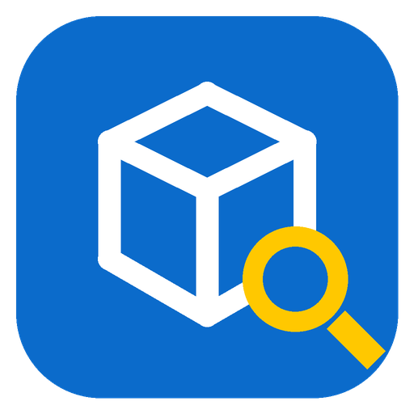

<div align="center">



# 🔎 Consulta Estoque

### Consulta de preço e estoque para lojas que usam o Small Commerce (Firebird), feita para o leitor de código de barras


**Passe o leitor e veja o preço na hora · Acha o banco sozinho na rede · Modo cópia (padrão) ou leitura direta · Nunca escreve no banco · Funciona sem internet e até com o servidor fora do ar · Do PC antigo (Windows 7, 32 bits) ao mais novo**

[Instalar](#instalacao) · [Usar](#uso) · [Leitor](#leitor) · [Modos](#modos) · [Banco automático](#banco) · [Configurar](#configuracao) · [PCs antigos](#antigos) · [Segurança](#seguranca) · [Problemas](#problemas)

</div>

---

## O que é

Um aplicativo de Windows, de **janela própria** (não abre no navegador), para consultar **preço e estoque** dos produtos do Small Commerce. Foi pensado para um computador no balcão ou no corredor da loja com um **leitor de código de barras USB ou Bluetooth**: passou o produto, o preço aparece grande na tela.

| | |
|---|---|
| 🏷️ **Cartão de preço** | O produto lido abre num cartão com o preço em destaque, o estoque, a unidade e o código de barras. A próxima leitura já substitui a anterior. |
| 🌐 **Acha o banco sozinho** | Procura o `SMALL.FDB` primeiro **na rede** (pelos atalhos e pela configuração do Small Commerce, pelas unidades de rede, pelo nome `SERVIDOR` e pela varredura) e só por último neste computador. Não precisa digitar nada. |
| 🔁 **Dois modos** | **Cópia** (padrão, como o Relatórios FDB-FBK): não pesa no caixa e funciona com o servidor fora do ar. **Leitura direta** (como o Relatórios SSH): preço e estoque do instante. |
| 💾 **Abre na hora** | O último estoque carregado fica salvo no computador e aparece assim que o aplicativo abre, mesmo sem rede. |
| 🔒 **Somente leitura** | Nunca grava nada no banco do Small Commerce. |
| 🖥️ **PCs antigos e novos** | Versão moderna (Windows 10/11, 64 bits) e versão **legado** (Windows 7 a 11, 64 e 32 bits). Modo leve sem animações. |

<a id="instalacao"></a>

## 🚀 Instalação em 2 passos

> **Requisitos:** Windows 7 ou mais novo · acesso ao servidor do Small Commerce pela rede (porta **3050** do Firebird). Não precisa instalar Node.js nem nada além do aplicativo.

1. **Baixe o arquivo certo** (na aba *Actions* do GitHub → última execução de **build** → *Artifacts*, ou o que o desenvolvedor enviar):

   | Computador | Arquivo |
   |---|---|
   | Windows 10 ou 11, 64 bits (a maioria) | `ConsultaEstoque-<versão>-win10-11-x64-instalador.exe` |
   | Windows 7, 8 ou 8.1 | `ConsultaEstoque-<versão>-legado-win7-a-11-x64-instalador.exe` |
   | Windows de **32 bits** (qualquer versão) | `ConsultaEstoque-<versão>-legado-win7-a-11-ia32-instalador.exe` |
   | Sem instalar (pendrive, pasta da rede) | o mesmo arquivo terminado em `-portatil.exe` |

   > 💡 Não sabe se o Windows é 32 ou 64 bits? *Configurações → Sistema → Sobre → Tipo de sistema* (no Windows 7: *Painel de Controle → Sistema*).

2. **Execute o instalador** e abra o **Consulta Estoque** pelo atalho da Área de Trabalho. Na primeira vez ele procura o banco sozinho; em alguns segundos o estoque aparece.

> ⚠️ O Windows pode mostrar "O Windows protegeu o computador" porque o aplicativo não tem assinatura digital paga. Clique em **Mais informações → Executar assim mesmo**.

<details>
<summary><b>Gerar o instalador no próprio computador (opcional)</b></summary>

Com o [Node.js](https://nodejs.org) 20 ou mais novo instalado, dê dois cliques em **`gerar-instalador.bat`** e escolha a versão. Os arquivos ficam na pasta `dist`. Pela linha de comando:

```powershell
npm ci
npm run dist          # Windows 10/11, 64 bits
npm run dist:legado   # Windows 7 a 11, 64 e 32 bits
```
</details>

<details>
<summary><b>Conhecer a tela sem banco (modo demonstração)</b></summary>

Abra com o parâmetro `--demo` (ex.: um atalho para `"Consulta Estoque.exe" --demo`). A tela mostra produtos de exemplo, sem conectar em banco nenhum.
</details>

---

<a id="uso"></a>

## 🖥️ Uso no dia a dia

| Quero… | Como |
|---|---|
| Ver o preço de um produto | **Passe o leitor** no código de barras. O cartão de preço abre sozinho. |
| Procurar pelo nome | Digite parte do nome (sem se preocupar com acentos ou maiúsculas): `racao gato`. |
| Procurar pelo código interno | Digite o código: `123` também acha `00123`. |
| Frase exata / excluir uma palavra | `"racao gato"` · `racao -filhote` |
| Ver todos os campos do produto | No cartão, clique em **Todos os campos do produto**. |
| Fechar o cartão | **Esc** ou o **×**. Um segundo **Esc** limpa a busca. |
| Filtrar | **Estoque** (com, sem, negativo, abaixo do mínimo), **Só ativos**, **Contém** e **Ordem**. Os filtros ficam guardados. |
| Exportar a lista | **Exportar** → planilha CSV (abre no Excel). |
| Atualizar agora | **Atualizar** ou **F5**. |
| Tela cheia | **Tela cheia** ou **F11**. |
| Aumentar/diminuir o texto | **Ctrl + +** / **Ctrl + −** / **Ctrl + 0**, ou *Configurações → Tela*. |
| Ver a situação do banco | Clique no indicador do topo (bolinha verde = atualizado, amarela = mostrando dados salvos, vermelha = sem conexão). |

<details>
<summary><b>Todos os atalhos de teclado</b></summary>

| Tecla | Ação |
|---|---|
| **Enter** | Busca e abre o produto lido (1 resultado ou 1 código exato) |
| **Esc** | Fecha o painel/cartão; depois limpa a busca |
| **F2**, **F3** ou **Ctrl+F** | Vai para a busca |
| **F5** | Atualiza o estoque agora |
| **F10** ou **Ctrl+,** | Configurações |
| **F11** | Tela cheia |
| **Ctrl + + / − / 0** | Tamanho do texto |
</details>

---

<a id="leitor"></a>

## 🏷️ Leitor de código de barras (USB ou Bluetooth)

O leitor funciona como um teclado: "digita" o código e manda **Enter**. O aplicativo foi feito em volta disso:

- **O campo de busca está sempre pronto.** Se o foco sair dele (um clique num botão, numa linha da lista), ele volta sozinho. Uma leitura com o foco em outro lugar também cai na busca.
- **Cada leitura substitui a anterior.** Depois do Enter o texto fica selecionado; o próximo código apaga o anterior, sem precisar limpar.
- **Abre o produto sozinho** quando há 1 resultado ou exatamente 1 produto com aquele código de barras, código ou referência. Funciona com EAN cadastrado com pontos ou espaços.
- **Produto fora dos filtros** (ex.: inativo com "Só ativos" ligado): a leitura mostra o produto mesmo assim, com um aviso.
- **Não achou:** cartão vermelho "Produto não encontrado" com o código lido.
- **Som** (opcional): bipe agudo quando acha, dois bipes graves quando não acha.
- **Leitor que termina com TAB** em vez de Enter: tratado como Enter (*Configurações → Tela*).
- **Fechar o cartão sozinho** após N segundos e limpar a busca, para uso como terminal de consulta de preço.

> 💡 Leitores Bluetooth no modo "HID/teclado" funcionam igual aos USB. Se o leitor estiver em outro modo (porta serial/SPP), mude-o para teclado conforme o manual dele.

---

<a id="modos"></a>

## 🔁 Modos de leitura

Escolha em *Configurações → Modo de leitura*. Nos dois modos o aplicativo **só lê** o banco.

| | **Cópia** (padrão) | **Leitura direta** |
|---|---|---|
| Inspirado em | Relatórios FDB-FBK | Relatórios SSH |
| Peso no banco do caixa | Mínimo: uma leitura a cada intervalo | Uma leitura da lista a cada intervalo + uma consulta pequena ao abrir cada produto |
| Atualidade | Do intervalo escolhido (padrão 10 min) | Lista a cada 60 s; **o produto aberto é relido na hora** (selo *Ao vivo*) |
| Servidor fora do ar | Continua consultando a última cópia | Mostra os dados salvos e avisa |

**Métodos da cópia:**

| Método | Como funciona | Quando usar |
|---|---|---|
| **Automático** (padrão) | Usa o **gbak** quando este computador tem o Firebird instalado e rodando; senão, o **instantâneo** | Sempre, salvo motivo específico |
| **gbak** | Backup do `SMALL.FDB` sem coleta de lixo (`gbak -b -g`) e restauração **somente leitura** no Firebird deste computador (`gbak -c -mode read_only`). O estoque é lido da cópia | Computador com Firebird instalado (mesma versão ou mais nova que a do servidor) |
| **Instantâneo** | Uma única leitura da tabela de produtos, em transação somente leitura, guardada na memória e em disco | Computador simples, sem Firebird |

<details>
<summary><b>Como a cópia por gbak é feita por dentro</b></summary>

1. Confere se o Firebird deste computador responde (porta 3050). Sem ele, o método automático usa o instantâneo.
2. `gbak -b -g SERVIDOR:C:\...\SMALL.FDB` gera o backup em `%ProgramData%\ConsultaEstoqueDesktop\copias`. O `-g` é uma leitura da "foto" atual do banco, sem coleta de lixo.
3. `gbak -c -mode read_only` restaura a cópia somente leitura no Firebird local (`SMALL_OFFLINE_AAAAMMDD_HHMMSS.FDB`).
4. A cópia nova só entra **pronta**: temporário → nome final → manifesto `copia.json`. Se algo falhar, a cópia anterior continua valendo.
5. Cópias antigas e temporários são apagados. Só arquivos com nome criado pelo próprio aplicativo, dentro da pasta das cópias.

- Usuário e senha vão ao gbak por **variável de ambiente** (`ISC_USER`/`ISC_PASSWORD`), nunca na linha de comando.
- O gbak roda com **prioridade abaixo do normal** (o caixa tem preferência).
- O intervalo entre cópias cresce para **3× a duração da última cópia**: o banco do caixa nunca fica ocupado mais que 1/3 do tempo.
- O gbak é procurado sozinho: configurado → serviço do Firebird em execução (mesma versão) → pastas conhecidas → `PATH`.
</details>

---

<a id="banco"></a>

## 🌐 Banco encontrado automaticamente

Na primeira vez, e sempre que o banco configurado falhar (servidor desligado, IP trocado, caminho errado), o aplicativo **procura o banco sozinho e atualiza a configuração**. A meta é ler **pela rede**; este computador é a última opção.

1. **A configuração do próprio Small Commerce.** Lê os `.ini`/`.cfg` deste computador, das **unidades de rede** (ex.: `H:` → `\\SERVIDOR\SmallSoft`), do compartilhamento `\\SERVIDOR\SmallSoft\Small Commerce` e dos **atalhos do Small** na Área de Trabalho e no Menu Iniciar. Ali está o endereço que o próprio Small usa, como `SERVIDOR:C:\Program Files (x86)\SmallSoft\Small Commerce\small.fdb`.
2. **Os servidores da rede.** Tenta os servidores citados nessas pistas, **pelo nome** (que não muda quando o IP muda), o configurado, o nome `SERVIDOR` e os que a varredura da rede encontrar com a porta 3050 aberta. A varredura cobre a rede local, a Tailscale e o cabo direto `169.254`.
3. **Por último, este computador** (`127.0.0.1`), se ele tiver o Firebird e um `SMALL.FDB`.

Regras:

- Só aceita arquivos chamados **`SMALL.FDB`**. `padrao.fdb`, `exemplo.fdb`, `off.fdb`, `monitor.fdb` e cópias de consulta ficam de fora.
- Só adota um banco que **abre** e tem a **tabela de produtos** do Small Commerce.
- Servidor que não responde é descartado em 1,5 s.
- Unidades de rede e de CD nunca entram na busca de arquivos `.FDB`. Abrir um banco por compartilhamento pode corrompê-lo; só o `.ini` é lido pela rede.
- Banco local escolhido sozinho continua sendo reavaliado: a cada atualização bem-sucedida o aplicativo volta a procurar o servidor da rede, no máximo a cada 5 minutos.
- Para travar o endereço e desligar a correção automática: *Configurações → Banco de dados → Não trocar o servidor sozinho*.

---

<a id="configuracao"></a>

## ⚙️ Configuração

Tudo pode ser feito na tela (*Configurações*, **F10**). Os valores ficam em `config.json`, na pasta de dados:

| Instalação | Pasta de dados |
|---|---|
| Instalador | `%APPDATA%\Consulta Estoque` |
| Portátil | `ConsultaEstoque-dados`, ao lado do `.exe` |
| Qualquer uma | variável de ambiente `CONSULTA_DESKTOP_DADOS` |

| Chave | Padrão | Para que serve |
|---|---|---|
| `modo` | `copia` | `copia` ou `direto` |
| `metodoCopia` | `auto` | `auto`, `gbak` ou `instantaneo` |
| `copiaACadaMin` | `10` | Intervalo da cópia (1 a 1440 min) |
| `copiaTimeoutMin` | `30` | Tempo máximo de cada cópia gbak (1 a 360 min) |
| `diretoRecarregarSeg` | `60` | Recarga da lista na leitura direta (15 a 3600 s) |
| `diretoItemAoVivo` | `true` | Reler estoque e preço ao abrir o produto (leitura direta) |
| `fbHost` / `fbPorta` | automático / `3050` | Servidor do Firebird (nome ou IP) |
| `fdbPath` | automático | Caminho do `SMALL.FDB` **no servidor** |
| `fbUser` / `fbPass` | `SYSDBA` / `masterkey` | Usuário e senha do Firebird |
| `fbHostFixo` | `false` | `true` = nunca trocar o servidor sozinho |
| `fbHostAuto` | — | Marcado pelo aplicativo quando o endereço foi encontrado sozinho |
| `varrerRede` | `true` | Procurar servidores Firebird na rede |
| `gbakPath` / `pastaCopias` | automático | Caminho do `gbak.exe` / pasta das cópias (sempre disco local) |
| `tema` | `auto` | `auto`, `claro` ou `escuro` |
| `zoom` | `1` | Tamanho do texto (0,6 a 2,5) |
| `fecharDetalheSeg` | `0` | Fechar o cartão sozinho após N s (0 = nunca) |
| `som` / `tabComoEnter` | `true` / `true` | Bipe na leitura / TAB do leitor vale como Enter |
| `mostrarCusto` | `false` | Mostrar o custo na lista e no cartão |
| `modoLeve` | `false` | Sem animações (PCs antigos) |
| `telaCheia` / `sempreNoTopo` | `false` | Abrir em tela cheia / ficar na frente das outras janelas |
| `iniciarComWindows` | `false` | Abrir junto com o Windows |
| `aceleracaoGrafica` | `true` | Desligue se a tela ficar preta ou piscando (reinicia) |
| `nomeLoja` | vazio | Nome exibido no topo |
| `limitePagina` | `100` | Itens por página da lista (20 a 1000) |

> Valor inválido ou fora da faixa volta ao padrão. `config.json` estragado é guardado como `config.json.corrompido-AAAAMMDD-HHMMSS` e o aplicativo abre com os padrões.

---

<a id="antigos"></a>

## 🖥️ PCs antigos e simples

- **Windows 7, 8 e 8.1** e **Windows de 32 bits**: use a versão **legado** (Electron 22.3.27, o último que roda nesses sistemas). O Electron atual não é mais publicado em 32 bits.
- **Pouca memória:** a lista mostra 100 itens por vez (rolagem infinita). A busca roda numa lista já preparada na memória, rápida mesmo com dezenas de milhares de produtos.
- **Modo leve** (*Configurações → Tela*): sem animações nem sombras.
- **Tela preta ou piscando** (placa de vídeo antiga): desmarque **Aceleração gráfica** ou abra com `--sem-gpu`.
- **Sem Firebird no computador:** o modo cópia usa o método instantâneo; não precisa instalar nada.

---

<a id="seguranca"></a>

## 🔒 Somente leitura e segurança

O aplicativo **nunca escreve no banco do Small Commerce**: nenhum `UPDATE`, `INSERT`, `DELETE` ou alteração de estrutura. Duas travas, em toda conexão:

1. **Comando:** só sai para o banco SQL que começa com `SELECT` ou `WITH`; qualquer outro é recusado antes.
2. **Transação:** toda leitura roda numa transação **somente leitura** do Firebird (READ COMMITTED + REC_VERSION, sem espera). A leitura nunca fica presa esperando o caixa gravar, e mesmo que um comando de escrita escapasse, o próprio Firebird recusaria.

A trava vale **só para as conexões deste aplicativo**: o banco não é colocado em modo somente leitura e o PDV continua gravando normalmente.

<details>
<summary><b>Demais proteções</b></summary>

- **Janela isolada:** `contextIsolation`, `sandbox` e sem Node na tela; a tela só fala com o aplicativo por uma ponte com funções fixas (`preload.js`). Pedidos de outra origem são recusados.
- **Política de conteúdo (CSP):** a tela não carrega nada da internet; nenhuma navegação para fora e nenhuma janela nova.
- **Senha do Firebird:** nunca aparece no log; vai ao gbak por variável de ambiente.
- **Exportação CSV** protegida contra fórmulas do Excel (`=`, `+`, `-`, `@`).
- **Gravações atômicas:** `config.json`, cache do estoque e manifesto da cópia são gravados num arquivo temporário e depois renomeados.
- **Acentos corretos:** texto lido como bytes (`OCTETS`) e decodificado como UTF-8, Windows-1252 ou latin1, como o banco do Small exige.
</details>

---

## 📜 Logs e diagnóstico

- `consulta-estoque.log` na pasta de dados (gira em 2 MB). Formato: `[DD-MM-AAAA] [HH:MM:SS] [CATEGORIA] mensagem`.
- Categorias: `INFO`, `AVISO`, `ERRO`, `BUSCA` (descoberta do banco) e `COPIA` (gbak).
- *Configurações → Diagnóstico* mostra o log ao vivo, as versões (aplicativo, Electron, Chromium, Node, Windows) e o botão **Abrir a pasta de dados**.

```text
[09-11-2026] [18:03:09] [BUSCA] Testando o banco nos servidores da rede: SERVIDOR, 192.168.0.10...
[09-11-2026] [18:03:10] [BUSCA] Banco encontrado em SERVIDOR:C:\Program Files (x86)\SmallSoft\Small Commerce\SMALL.FDB — configuração atualizada automaticamente.
[09-11-2026] [18:03:12] [INFO] Estoque carregado (cópia instantânea de SERVIDOR:C:\...\SMALL.FDB): 15320 itens da tabela ESTOQUE (código: CODIGO, descrição: DESCRICAO, barras: REFERENCIA, estoque: QTD_ATUAL, preço: PRECO).
```

---

## 🧰 Tecnologias e bibliotecas

Uma única biblioteca em uso pelo aplicativo (`node-firebird`); o resto é o próprio Electron/Node.

| Parte | Tecnologia | Versão | Para quê |
|---|---|---|---|
| Aplicativo | [Electron](https://www.electronjs.org) | 44.9.3 (Chromium 152, Node 24) | Janela própria do Windows 10/11 |
| Aplicativo legado | Electron | 22.3.27 (Chromium 108, Node 16) | Windows 7/8/8.1 e 32 bits |
| Banco | [node-firebird](https://www.npmjs.com/package/node-firebird) | 2.19.1 | Driver Firebird em JavaScript puro (sem DLL), com a trava somente leitura deste projeto |
| Cópia | `gbak` do Firebird | do Firebird instalado | Backup sem coleta de lixo + restauração somente leitura |
| Instalador | [electron-builder](https://www.electron.build) | 26.18.0 | Instalador NSIS e versão portátil, x64 e ia32 |
| Tela | HTML5, CSS e JavaScript sem framework | — | Leve para PCs fracos; temas claro e escuro |
| Som | Web Audio API | — | Bipe da leitura, sem arquivos de áudio |
| Testes | `node:test` + `node:assert` | Node 20+ | 38 testes com Firebird e gbak simulados |
| Teste da tela | Playwright + Electron | — | Fluxo do leitor, cartão, configurações, tema e Electron 22 |
| Build | GitHub Actions | — | Testes + instaladores a cada push |

---

## 🧪 Testes

```bash
npm test
```

- **38 testes**, sem Firebird real:
  - **Firebird simulado** (`src/demo.js`): registra toda SQL e transação, para provar que nada de escrita sai;
  - **gbak simulado** (`test/mock-gbak.js`): backup, restauração, falhas e atraso.
- **Trava de somente leitura:** comandos recusados, transação somente leitura, `node-firebird` 0.x e 1.x+.
- **Leitura do banco:** acentos, papéis das colunas (EAN em `REFERENCIA`), `OCTETS` recusado, banco sem tabela.
- **Busca:** acentos, EAN, zeros à esquerda, exclusão e filtros.
- **Cache em disco:** ida e volta; CSV protegido.
- **Descoberta:** rede antes do local, só `SMALL.FDB`, unidade mapeada, `.ini` do compartilhamento, atalho `.lnk`, servidor fora do ar, senha errada.
- **Motor:** auto-correção do endereço, `fbHostFixo`, dados salvos sem rede, item ao vivo na leitura direta, troca de modo, gbak ausente.
- **Cópia gbak:** senha por variável de ambiente, cópia nova atômica, limpeza segura, falha mantém a anterior, cancelamento.

---

## 🗂️ Como é organizado

| Arquivo | Função |
|---|---|
| `main.js` | Processo principal: janela, instância única, pasta de dados, IPC |
| `preload.js` | Ponte segura entre a tela e o aplicativo |
| `ui/index.html`, `ui/estilo.css`, `ui/app.js` | A tela (busca, cartão de preço, lista, configurações) |
| `src/motor.js` | Modos, atualização, cache em disco, auto-correção do banco |
| `src/firebird.js` | Conexão Firebird com trava somente leitura, prazos e mensagens de erro |
| `src/estoque-dados.js` | Leitura da tabela de produtos e papéis das colunas |
| `src/estoque-busca.js` | Regras da busca (as mesmas do Relatórios FDB-FBK) |
| `src/localizar-banco.js` | Descoberta automática do banco na rede e no computador |
| `src/copia-gbak.js` | Cópia por gbak (backup + restauração somente leitura) |
| `src/config.js`, `src/registro.js` | Configuração validada e log |
| `src/demo.js` | Firebird simulado (testes e `--demo`) |
| `electron-builder.config.js` | Variantes moderna e legado do instalador |
| `gerar-instalador.bat` | Gera os instaladores com dois cliques |
| `.github/workflows/build.yml` | CI: testes e instaladores |
| `CHANGELOG.md`, `CLAUDE.md` | Histórico de versões e regras do projeto |

---

<a id="problemas"></a>

## 🩺 Solução de problemas

| Sintoma | O que fazer |
|---|---|
| "Sem conexão com o banco" | Confira se o servidor do Small Commerce está ligado e na mesma rede. Clique em **Procurar o banco**. Veja o motivo em *Configurações → Banco de dados* |
| Achou o banco errado | *Configurações → Banco de dados*: digite o servidor e o caminho do `SMALL.FDB` (o mesmo de *Small Commerce → Sobre → Url do FDB*) e marque **Não trocar o servidor sozinho** |
| "Usuário ou senha do Firebird recusados" | Ajuste usuário e senha em *Configurações → Banco de dados* |
| Indicador amarelo "Dados salvos de…" | O servidor não respondeu; a consulta segue com o último estoque. Atualiza sozinho quando o servidor voltar |
| Leitor não abre o produto | Confira se o leitor envia **Enter** (ou TAB, com a opção ligada). Teste num Bloco de Notas: o código deve aparecer e pular de linha |
| Método gbak: "gbak não encontrado" / "Firebird desta máquina não está rodando" | Use **Automático** ou **Instantâneo**, ou instale o Firebird (mesma versão do servidor) |
| "Versão do Firebird local incompatível" | O Firebird deste computador precisa ser da mesma versão ou mais novo que o do servidor; ou use **Instantâneo** |
| Tela preta ou piscando | Desmarque **Aceleração gráfica** ou abra com `--sem-gpu` |
| Windows 7/8 ou 32 bits não abre | Use a versão **legado** |
| Acentos estranhos | Informe o log ao desenvolvedor; o aplicativo tenta UTF-8, Windows-1252 e latin1 sozinho |

---

O histórico completo de cada arquivo está em [`CHANGELOG.md`](CHANGELOG.md).

<div align="center">

**Desenvolvido por Ruda Gabriel** — concepção, regras de negócio e manutenção.

© 2026 Ruda Gabriel. Todos os direitos reservados.

</div>
